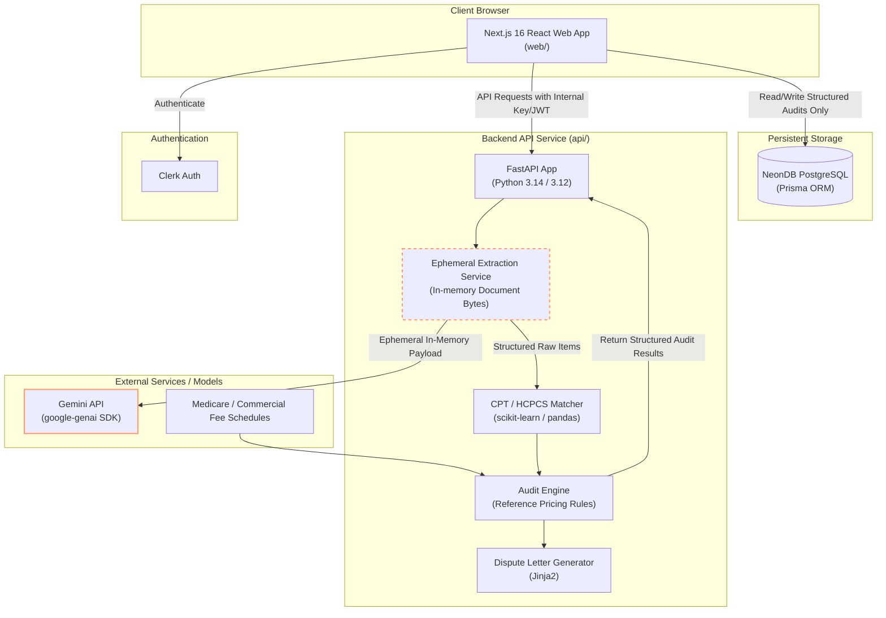

# FairBill

FairBill is an open-source medical bill auditing platform designed to empower patients by analyzing itemized hospital and clinical charges to identify **possible overcharges**. FairBill provides transparent, data-driven financial insights and customizable dispute letters without compromising patient privacy or accusing healthcare providers of wrongdoing.

---

## Key Features & Principles

- **Zero-Retention Privacy**: Uploaded medical bills (PDFs, images) and raw OCR bill text are processed ephemerally in-memory and **never** written to disk, persistent databases, or log files. Only structured, anonymized audit line items are retained.
- **Objective & Non-Accusatory Analysis**: All findings flag **"possible overcharges"** by comparing charges against regional Medicare Fee Schedules and commercial benchmark pricing distributions. FairBill never accuses healthcare providers of fraud or malpractice and does not provide legal advice.
- **Automated Dispute Letter Generation**: Generates polite, formal requests for itemized billing statements, coding clarifications, and charge reconsiderations tailored to audit results.

---

## Screenshots Placeholder

> *Screenshots of the FairBill application UI will be placed here.*

| Dashboard & Bill Upload | Audit Results & Findings | Dispute Letter Generator |
|:---:|:---:|:---:|
|  |  |  |

---

## Architecture Diagram

The FairBill monorepo consists of a **Next.js 16** frontend web dashboard and a **FastAPI** Python microservice backend. Uploaded documents are handled purely in-memory and processed ephemerally through AI extraction pipelines.



*Note: Document files and raw OCR text exist only within the ephemeral extraction step in memory and are discarded immediately after structured item extraction.*

---

## Run Locally

### Prerequisites

- **Node.js** v20+ and `npm`
- **Python** 3.12+ (or Python 3.14)
- **Make** (optional, for convenience checks)

### 1. Web Service (Next.js)

```bash
cd web
cp .env.example .env.local
npm install
npm run dev
```

The web dashboard runs at `http://localhost:3000`.

### 2. API Service (FastAPI)

```bash
cd api
cp .env.example .env

# Create Python virtual environment
# Linux / macOS:
python3 -m venv .venv
source .venv/bin/activate

# Windows (Command Prompt / PowerShell):
# py -3.14 -m venv .venv
# .venv\Scripts\activate

# Install dependencies and start server
pip install -r requirements-dev.txt
uvicorn app.main:app --reload --port 8000
```

The API service runs at `http://localhost:8000`. Interactive OpenAPI documentation is accessible at `http://localhost:8000/docs`.

### 3. Running Code Verification Suite

To run all lints, type checks, unit tests, and production builds across both `web/` and `api/`:

```bash
make check
```

---

## Product & Technical Roadmap

- [x] **Core Audit Engine**: Basic rule checks for price benchmarks, arithmetic mismatches, duplicate line items, GST inconsistencies, and unbundled codes.
- [x] **Zero-Retention Pipeline Guarantee**: Strictly in-memory document processing without disk or database persistence of raw files.
- [x] **Dispute Letter Generator**: Automated creation of non-accusatory dispute letters.
- [ ] **Expanded Fee Schedule Support**: Support for state-specific Medicaid rates and regional commercial insurance percentiles (e.g., FAIR Health benchmarks).
- [ ] **Multimodal OCR & Document Parsing**: Full integration of Gemini Vision API (`google-genai` SDK) for complex multi-page PDF medical bill extraction.
- [ ] **Interactive Audit Customization**: Allow users to adjust threshold percentages and toggle individual billing rules before generating dispute letters.
- [ ] **Export & Download Options**: Export audit reports and dispute letters directly to PDF and DOCX formats.
- [ ] **Localized Benchmark Support**: Extend fee schedule matching to international healthcare billing models.

---

## License

FairBill is distributed under the [MIT License](LICENSE).
